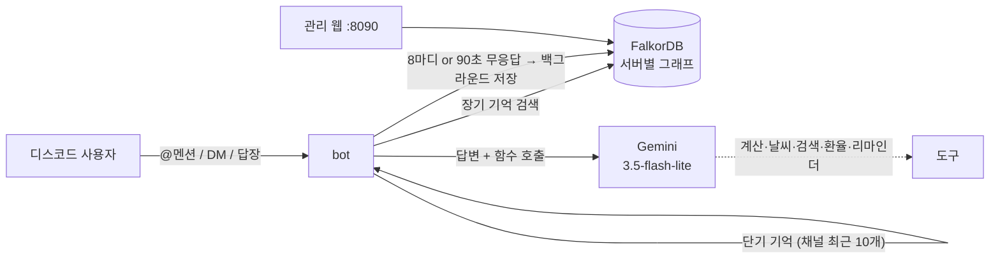

# Studyme v5 The best and the last model

Graphiti(시간 인식 지식 그래프) + FalkorDB + Gemini 로 만든, **대화를 오래 기억하고 계산·날씨·검색까지 해 주는 디스코드 봇**입니다.
`docker compose` 한 번으로 FalkorDB · 봇 · 기억 관리 웹이 함께 뜹니다.
앞으로의 스터디미 개발은 없을 것이고 현재 기능을 추가하고 유지보수 하는 방식일 것입니다.

 **자세한 설명은 [상세 가이드 (docs/GUIDE.md)](docs/GUIDE.md)** — 사용자 체크리스트, 관리 체계, 페르소나, 도구, 운영·백업·문제 해결



## 기능

- **장기 기억** — 대화를 지식 그래프로 저장하고, 답할 때 관련 기억을 떠올림. 서버(`guild-…`)·DM(`dm-…`)별로 완전히 분리
- **토큰 절약** — 메시지마다 저장하지 않고 8마디/90초 단위로 묶어 백그라운드 저장, 429 자동 재시도
- **대화 도구** — 계산, 날씨, 구글 검색, 환율, D-day, 세계 시각, 메뉴 고르기·주사위, **리마인더**, 기억 재검색 ([도구 목록](docs/GUIDE.md#️-대화-도구-gemini-function-calling))
- **관리 웹** — 기억 그래프 시각화, 사실 수정·만료·삭제, 원본 대화, 의미 검색, 저장 로그 ([관리 체계](docs/GUIDE.md#️-관리-체계-admin))
- **페르소나** — 관리 웹 ⚙ 봇 설정 또는 `config/persona.md` 로 말투·성격 변경, 재시작 불필요 ([페르소나](docs/GUIDE.md#-페르소나-바꾸기))

## 빠른 시작

1. Discord Developer Portal 에서 봇을 만들고 **MESSAGE CONTENT INTENT** 를 켠 뒤 서버에 초대
2. Docker Desktop 설치 후 실행
3. 설정 파일 만들기 → `DISCORD_TOKEN`, `GEMINI_API_KEY`, `ADMIN_PASSWORD` 입력
   ```bash
   cp .env.example .env
   ```
4. 실행
   ```bash
   docker compose up -d --build
   ```
5. 디스코드에서 `@라스페치아 안녕` → 관리 웹 `http://localhost:8090` (아이디 `admin`)

다른 기기에서 관리 웹 접속, 토큰 교체, 백업 등 **사용자가 직접 해야 할 일**은 [체크리스트](docs/GUIDE.md#-사용자가-해야-할-일-체크리스트)에 정리되어 있습니다.

## 자주 쓰는 명령

| 하고 싶은 것 | 명령 |
|---|---|
| 시작 / 업데이트 반영 | `docker compose up -d --build` |
| 봇 로그 보기 | `docker compose logs -f bot` |
| 중지 (기억 유지) | `docker compose down` |

## 디스코드에서

- `@라스페치아 …` / 봇 메시지에 답장 / DM → 대화
- `/memory recall <질문>` 기억 검색 · `/memory save` 지금 저장 · `/memory status` 저장 현황

## 프로젝트 구조

```
app/
  bot.py            디스코드 봇 (메시지 처리, 슬래시 명령, 리마인더 발송)
  chat.py           답변 생성 + 함수 호출 루프
  memory.py         Graphiti(FalkorDB + Gemini) 장기 기억
  batcher.py        배칭·디바운스 저장, 재시도, 실패 보관
  persona.py        봇 이름·페르소나 (웹 > 파일 > .env > 기본값)
  tools/            함수 호출 도구 (basic, web, reminders, memory_tool)
  admin/            관리 웹 (FastAPI + 정적 프런트엔드)
config/persona.md   페르소나 파일
docs/GUIDE.md       상세 가이드
```
