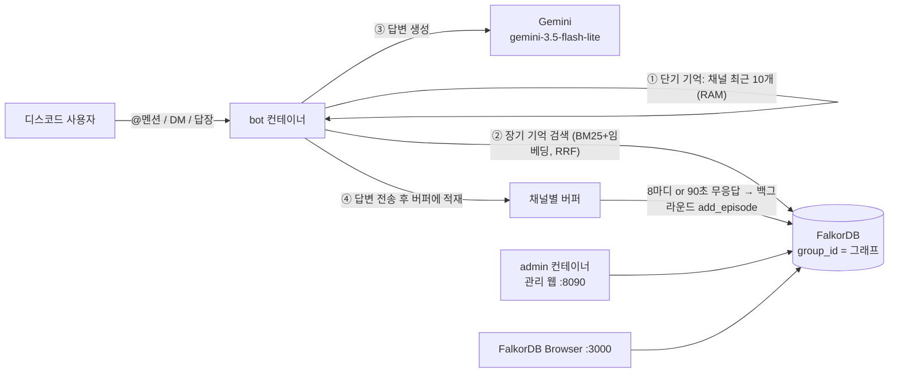

# 🧠 디스코드 장기 기억 AI 봇

Graphiti(시간 인식 지식 그래프) + FalkorDB + Gemini 로 만든, **대화를 오래 기억하는 디스코드 봇**입니다.
홈서버에서 `docker compose` 한 번으로 FalkorDB · 봇 · 기억 관리 웹이 함께 뜹니다.



## 핵심 설계

| 요구사항 | 구현 |
|---|---|
| OpenAI/Neo4j 기본값 오버라이드 | `FalkorDriver` + `GeminiClient` / `GeminiEmbedder` / `GeminiRerankerClient` 를 직접 주입 ([app/memory.py](app/memory.py)) |
| 비동기 논블로킹 저장 | 답변을 **보낸 뒤에** 버퍼에 넣고, 저장은 `asyncio` 백그라운드 태스크 ([app/bot.py](app/bot.py)) |
| 토큰 방어 배칭 | 채널별 버퍼에 모아 **8마디** 또는 **90초 무응답(디바운스)** 시 한 번에 `add_episode` ([app/batcher.py](app/batcher.py)) |
| 기억 공간 격리 | 서버 = `guild-<guild_id>`, DM = `dm-<user_id>` 를 `group_id` 로 사용 → FalkorDB 에서는 **그래프 자체가 분리**됨 |
| 429 방어 | 공용 RPM 제한기 + 호출 단위 지수 백오프 재시도 + 에피소드 동시 실행 세마포어 + 그룹별 순차 처리 ([app/gemini_resilience.py](app/gemini_resilience.py)) |
| 크래시 방지 | 저장 실패는 로그만 남기고 `data/failed_episodes.jsonl` 에 보관 → 다음 기동 때 자동 재처리 |
| 운영 | `restart: unless-stopped`, FalkorDB AOF 영속화 볼륨, `docker stop` 시 남은 버퍼 저장 후 종료 |

### 가이드라인과 다르게 판단한 부분 (의도적)

- **임베딩 모델**: `gemini-3.5-flash-lite` 는 생성형 모델이라 임베딩을 만들 수 없습니다 (`embedContent` 미지원). LLM·리랭커·채팅은 `gemini-3.5-flash-lite` 로 통일하고 임베딩만 `gemini-embedding-001` 을 씁니다.
- **429 재시도 위치**: Graphiti 의 `GeminiClient` 는 429 를 받으면 재시도 없이 즉시 실패해 그때까지 쓴 토큰이 전부 버려집니다. 그래서 클라이언트를 서브클래싱해 **개별 호출 단위**로 백오프 재시도하도록 바꿨습니다.
- **임베딩 배치**: Graphiti 는 `gemini-embedding-001` 을 1건씩 호출하도록 하드코딩돼 있지만, 실제로는 배치를 지원해서 `batch_size=100` 으로 덮어써 요청 수를 크게 줄였습니다.
- **사고 토큰**: 그래프 추출은 `thinking_level=minimal`, 채팅은 `low` 로 사고 토큰을 줄였습니다.
- **10자 규칙 보정**: 봇과 무관한 대화는 10자 미만이면 무시합니다. 다만 봇에게 **직접** 한 말은 "내 이름은 건우야"(9자)처럼 짧은 사실일 수 있어서 `ㅋㅋ`, `ㅇㅇ`, 이모지 같은 추임새만 거릅니다.
- **기억 검색**: 답변용 검색은 LLM 리랭커 없이 RRF(BM25 + 벡터)만 써서 **질문당 임베딩 1회** 외에는 토큰을 쓰지 않습니다. 아직 기억이 없는 공간은 검색 자체를 건너뜁니다.
- **group_id 접두어**: 숫자 ID만 쓰면 서버와 DM을 구분할 수 없어 `guild-`/`dm-` 접두어를 붙였습니다.
- **기억 범위**: 기본값은 봇과 주고받은 대화만 저장합니다. 채널의 모든 대화를 기억하게 하려면 `CAPTURE_ALL_MESSAGES=true` 로 켜면 됩니다(토큰 사용량이 늘어남).
- **텔레메트리**: Graphiti 의 익명 텔레메트리는 기본으로 꺼 두었습니다.


---

## ✅ 사용자가 해야 할 일 (체크리스트)

봇은 대부분 자동으로 돌아가지만, **계정·보안·네트워크 관련 설정은 직접** 해야 합니다.

### A. 처음 한 번

| # | 할 일 | 어디서 | 비고 |
|---|---|---|---|
| 1 | 봇 생성 + **MESSAGE CONTENT INTENT 켜기** | [Discord Developer Portal](https://discord.com/developers/applications) → Bot | 안 켜면 멘션해도 무반응 |
| 2 | 봇을 서버에 초대 | Developer Portal → OAuth2 → URL Generator | scopes `bot`, `applications.commands` / 권한 `View Channels`, `Send Messages`, `Read Message History` |
| 3 | Gemini API 키 발급 | [Google AI Studio](https://aistudio.google.com/apikey) | 무료 티어면 `.env`에 `GEMINI_RPM=10` 권장 |
| 4 | Docker Desktop 설치 → 실행 → 약관 동의 | 이 PC | WSL2 설치 안내가 나오면 따라 하고 재부팅 |
| 5 | `.env` 작성 | 프로젝트 폴더 | `cp .env.example .env` 후 `DISCORD_TOKEN`, `GEMINI_API_KEY`, **`ADMIN_PASSWORD`** 입력 |
| 6 | 실행 | 프로젝트 폴더 | `docker compose up -d --build` |
| 7 | (다른 기기에서 관리 웹을 쓰려면) 방화벽 허용 | 관리자 PowerShell | 아래 [다른 기기에서 접속](#다른-기기에서-접속-같은-와이파이--tailscale) 참고 |
| 8 | (선택) 페르소나 작성 | 관리 웹 → ⚙ 봇 설정, 또는 `config/persona.md` | 아래 [페르소나 바꾸기](#-페르소나-바꾸기) 참고 |

### B. 가끔 / 상황별

| 상황 | 할 일 |
|---|---|
| **토큰이 유출됐거나 바꾸고 싶을 때** | Developer Portal → Bot → **Reset Token** → `.env`의 `DISCORD_TOKEN` 교체 → `docker compose up -d` |
| Gemini 키 교체 | `.env`의 `GEMINI_API_KEY` 교체 → `docker compose up -d` |
| 관리 웹 비밀번호 변경 | `.env`의 `ADMIN_PASSWORD` 교체 → `docker compose up -d admin` |
| 코드 업데이트 후 | `git pull` → `docker compose up -d --build` |
| PC 재부팅 후 | Docker Desktop이 켜지면 컨테이너는 자동 재시작 (`unless-stopped`). Docker Desktop **자동 시작**을 켜 두면 편함 (Settings → General → *Start Docker Desktop when you sign in*) |
| 주 1회 정도 | 관리 웹 **저장 로그**에서 실패(⚠️) 확인, [백업](#백업--복원) |
| 이상한 기억 발견 | 관리 웹에서 해당 사실을 **만료** 또는 **수정** (아래 [관리 원칙](#관리-원칙-만료-vs-삭제)) |

> ⚠️ `.env`에는 토큰·키·비밀번호가 들어 있습니다. **절대 GitHub에 올리거나 채팅에 붙여 넣지 마세요.** (`.gitignore`, `.dockerignore`로 이미 제외되어 있음)

---

## 🛡️ 관리 체계 (Admin)

### 구성 요소와 권한

| 구성 요소 | 주소 | 인증 | 할 수 있는 일 | 누구용 |
|---|---|---|---|---|
| **관리 웹** (admin) | `http://<PC IP>:8090` | HTTP Basic (`ADMIN_USER` / `ADMIN_PASSWORD`) | 기억 조회·수정·만료·삭제, 공간 삭제, 봇 이름·페르소나 변경, 저장 로그 | 봇 관리자 |
| **디스코드 슬래시 명령** | 디스코드 | 디스코드 계정 | `/memory recall·save·status` (자기 서버/DM 범위만, 결과는 본인에게만 보임) | 모든 사용자 |
| **FalkorDB Browser** | `http://<PC IP>:3000` | **없음** ⚠️ | 원본 그래프 직접 조회·Cypher 실행 (수정·삭제도 가능) | 개발/디버깅 |
| **docker / .env** | 이 PC | PC 로그인 | 토큰·키·비밀번호, 시작/중지, 백업 | PC 주인 |

- 관리 웹은 **하나의 관리자 계정**만 있습니다(역할 구분 없음). 비밀번호를 아는 사람은 모든 서버의 기억을 보고 지울 수 있으니 공유에 주의하세요.
- `ADMIN_PASSWORD`를 비워 두면 **인증 없이** 열리고, 화면 상단에 노란 경고가 뜹니다.
- 디스코드 사용자는 **자기 서버(또는 자기 DM)의 기억만** 검색할 수 있습니다. 다른 서버의 기억은 그래프 자체가 분리되어 있어 접근할 수 없습니다.
- FalkorDB Browser는 인증이 없으므로, 필요 없다면 `docker-compose.yml`에서 `3000` 포트 줄을 주석 처리하세요.

### 관리 웹 화면별 기능

| 화면 | 기능 |
|---|---|
| 왼쪽 **기억 공간** | 서버(`guild-…`)·DM(`dm-…`) 목록, 엔티티/사실 수. 아래쪽에 봇 상태(누적 저장, 실패, 대기 버퍼) |
| 상단 **상태 표시** | 🟢 봇 온라인 · 대기 중인 대화 수 · 저장 중 작업 수 (90초 이상 보고 없으면 🔴 오프라인) |
| **⚙ 봇 설정** | 봇 이름·페르소나 편집, 예시 불러오기, 저장 전 **미리보기**, 파일 값으로 되돌리기 |
| **그래프** | 엔티티-관계 네트워크. 노드 크기 = 연결 수, 빨간 점선 = 만료된 사실. 노드 클릭 → 상세 패널 |
| 상세 패널 | 엔티티 요약 수정, 연결된 사실(수정·만료·삭제), 이 엔티티가 언급된 원본 대화, 엔티티 삭제 |
| **사실** | 모든 관계(사실) 목록·필터. 문장 수정 시 임베딩 자동 재계산 |
| **에피소드** | 한 번에 저장된 원본 대화 묶음. 삭제하면 그 대화에서만 생긴 엔티티/사실도 정리 |
| **의미 검색** | 봇이 답변할 때 쓰는 것과 같은 검색(BM25+임베딩)으로 "봇이 무엇을 떠올릴지" 확인 |
| **저장 로그** | 저장 성공(✅ 엔티티·관계 수, 소요 시간)과 실패(⚠️ 오류 내용) 기록 |
| **공간 삭제** | 탭 줄 오른쪽. 공간 ID를 직접 입력해야 실행되는 **영구 삭제** |

### 관리 원칙: 만료 vs 삭제

| 상황 | 권장 동작 | 이유 |
|---|---|---|
| 예전엔 맞았지만 지금은 아님 (이사, 퇴사, 헤어짐) | **만료** | 봇이 "과거 사실"로 알고 시간 맥락을 유지 |
| 사실 문장이 조금 틀림 | **수정** | 임베딩까지 다시 계산되어 검색에 반영 |
| 애초에 잘못 추출됨 / 사적인 정보라 지워야 함 | **삭제** | 완전히 제거 (되돌릴 수 없음) |
| 특정 대화 전체를 잊게 하고 싶음 | 에피소드 **삭제** | 그 대화에서만 생긴 엔티티·사실까지 함께 정리 |
| 서버를 떠났거나 처음부터 다시 | **공간 삭제** | 그 서버의 그래프 전체 삭제 |

삭제는 되돌릴 수 없으니, 중요한 정리 전에는 [백업](#백업--복원)을 먼저 하세요.

### 다른 기기에서 접속 (같은 와이파이 · Tailscale)

컨테이너는 이미 모든 네트워크 주소(`0.0.0.0:8090`)로 열려 있습니다. Windows 방화벽만 허용하면 됩니다. **관리자 PowerShell**에서 한 번만:

```powershell
Set-NetConnectionProfile -InterfaceAlias "Wi-Fi" -NetworkCategory Private
```

```powershell
Set-NetFirewallRule -DisplayName "Docker Desktop Backend" -Action Allow -Profile Private
```

- 첫 줄: 집 와이파이를 '개인 네트워크'로 지정 (공용 와이파이에서는 계속 차단됨)
- 둘째 줄: Docker 설치 때 만들어진 **차단** 규칙을 개인 네트워크에서만 **허용**으로 변경
- 접속: 같은 와이파이의 휴대폰/PC에서 `http://<이 PC의 IP>:8090` (IP 확인: `ipconfig` → Wi-Fi의 IPv4 주소)
- Tailscale을 쓰면 밖에서도 `http://<Tailscale IP>:8090` 으로 접속 가능
- 공유기가 IP를 바꿀 수 있으니, 공유기 설정에서 이 PC에 **고정 IP(DHCP 예약)** 를 지정해 두면 편합니다.
- **인터넷(공유기 포트포워딩)에 공개하는 것은 권장하지 않습니다.** 밖에서 쓰려면 Tailscale을 쓰세요.

---

## 🎭 페르소나 바꾸기

봇의 이름·말투·성격은 코드를 건드리지 않고 바꿀 수 있습니다. **봇 재시작도 필요 없습니다** (몇 초 안에 다음 답변부터 반영).

**방법 1 — 관리 웹 (가장 쉬움)**
1. 관리 웹 오른쪽 위 **⚙ 봇 설정**
2. 이름·페르소나 입력 (또는 *다정한 친구 / 츤데레 / 집사 / 공부 멘토* 예시 불러오기)
3. 오른쪽 **미리보기**에 메시지를 보내 말투 확인 → **저장**

**방법 2 — 파일 (`config/persona.md`)**
- 메모장으로 열어 고치고 저장하면 끝. `#`으로 시작하는 줄은 메모로 무시됩니다.
- git에 함께 저장되므로 페르소나 변경 이력을 남기고 싶을 때 좋습니다.

**적용 우선순위**: 관리 웹에서 저장한 값 → `config/persona.md` → `.env`의 `BOT_NAME`/`BOT_PERSONA` → 기본값.
관리 웹에서 **파일 값으로 되돌리기**를 누르면 웹 값이 지워지고 `config/persona.md`가 다시 쓰입니다.

**잘 쓰는 팁**
- "너는 ~다"로 정체성 → 말투 → 성격 → 금지 규칙 순서로 짧게 쓰세요.
- 너무 길면(수천 자) 매 답변마다 토큰이 늘어납니다. 보통 300~800자면 충분합니다.
- 기억 활용 방식(관련 있을 때만 자연스럽게 꺼내기, 지어내지 않기)과 답변 길이 규칙은 코드에 이미 들어 있어서 페르소나에 쓰지 않아도 됩니다.
- 디스코드에 **표시되는** 이름/프로필 사진은 Developer Portal 또는 서버 닉네임에서 따로 바꿔야 합니다.

---

## 🧰 운영 명령어

| 하고 싶은 것 | 명령 |
|---|---|
| 전체 시작 / 업데이트 반영 | `docker compose up -d --build` |
| 상태 보기 | `docker compose ps` |
| 봇 로그 실시간 | `docker compose logs -f bot` |
| 봇만 재시작 | `docker compose restart bot` |
| 전체 중지 (기억은 유지) | `docker compose down` |
| ⚠️ 기억까지 전부 삭제 | `docker compose down -v` |

## 검증 (기억이 제대로 쌓이는지)

봇을 멘션해 몇 마디 나눈 뒤 90초 기다리거나 `/memory save`:

```
[guild-123] 배치 확정(idle): 4마디 312자 → 백그라운드 저장 예약
[guild-123] ✅ 장기 기억 저장 완료 (7.1s): 4마디 → 엔티티 4, 관계 2
```

`🦀 LLM generation failed parsing as JSON` 또는 `❌ 장기 기억 저장 최종 실패`가 보이면 그 로그만 복사해 수정을 요청하세요.
(`gemini-3.5-flash-lite`로 엔티티/관계/요약 추출 + 임베딩까지 파싱 오류 없이 동작 확인. 4마디 대화 1건 ≈ 7천 토큰.)

그래프 확인: 관리 웹 → 서버 선택 → **그래프** 탭. 또는 FalkorDB Browser(3000) → Host `localhost`, Port `6379` → 그래프 `guild-<서버ID>`:

```cypher
MATCH (a:Entity)-[r:RELATES_TO]->(b:Entity) RETURN a, r, b LIMIT 100
```

## 디스코드 사용법

- 서버: `@라스페치아 안녕` 또는 봇 메시지에 답장 · DM: 그냥 말하기
- `/memory recall <질문>` — 이 서버(또는 DM)의 장기 기억 검색 (본인에게만 보임)
- `/memory save` — 이 채널에 쌓인 대화를 지금 바로 저장
- `/memory status` — 대기 버퍼·저장 현황

슬래시 명령은 처음 반영까지 최대 1시간. `.env`에 `DEV_GUILD_ID=<서버ID>`를 넣으면 그 서버엔 즉시 반영됩니다.

## 백업 / 복원

```bash
# 백업 (프로젝트 폴더에 falkordb-backup.tgz 생성)
docker run --rm -v memory-bot_falkordb_data:/data -v "$PWD":/backup alpine tar czf /backup/falkordb-backup.tgz -C /data .

# 복원 (먼저 docker compose down)
docker run --rm -v memory-bot_falkordb_data:/data -v "$PWD":/backup alpine sh -c "cd /data && tar xzf /backup/falkordb-backup.tgz"
```

## 로컬 개발

```bash
python -m venv .venv && .venv/Scripts/activate      # Windows
pip install -r requirements-dev.txt
pytest                                              # 배칭·재시도·페르소나 단위 테스트
python main.py          # 봇 (FalkorDB 없으면 단기 기억만으로 동작, 연결되면 자동 반영)
python main.py admin    # 관리 웹 → http://localhost:8000 (FalkorDB 필요)
```

## 문제 해결

| 증상 | 확인할 것 |
|---|---|
| 멘션해도 반응 없음 | Developer Portal에서 **MESSAGE CONTENT INTENT** 켰는지, `docker compose logs bot`에 `로그인:` 줄이 있는지 |
| 같은 토큰을 다른 봇 프로그램도 쓰는 중 | 한 토큰은 한 프로그램만 쓰세요. 둘 다 응답하거나 서로 끊깁니다 |
| `RateLimitError` / 429 반복 | `.env`에 `GEMINI_RPM=10`, `MAX_CONCURRENT_EPISODES=1` 유지 |
| 다른 기기에서 관리 웹 접속 안 됨 | [방화벽 설정](#다른-기기에서-접속-같은-와이파이--tailscale), 같은 와이파이인지, PC IP가 바뀌지 않았는지 |
| `port is already allocated` | `.env`의 `ADMIN_WEB_PORT`(기본 8090) / `FALKORDB_BROWSER_PORT`(기본 3000)를 다른 번호로 |
| 관리 웹에 공간이 안 보임 | 아직 저장된 에피소드가 없음 (90초 대기 또는 `/memory save`) |
| 저장 실패분이 걱정됨 | `bot_data` 볼륨의 `failed_episodes.jsonl`에 보관 → 봇 재시작/DB 재연결 시 자동 재처리 |
| 페르소나가 안 바뀜 | 관리 웹 상단 배지가 "관리 웹에서 설정한 값"이면 파일보다 웹 값이 우선. **파일 값으로 되돌리기** 클릭 |
